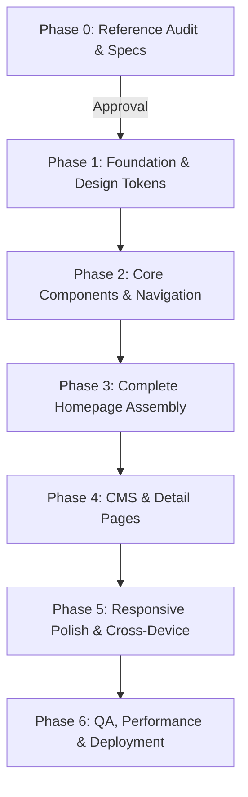

# PixelCraft Studios — Implementation Roadmap

**Project**: PixelCraft Studios Modern Agency Web Application  
**Design Reference**: Scalient Architecture  
**Auditor / Lead Engineer**: Senior Frontend Specialist  
**Execution Phase**: Phase 0 Complete — Awaiting Approval for Phase 1

---

## 1. Proposed Technical Architecture

To achieve the design fidelity, fluid animations, sub-second load times, and responsive behavior observed on Scalient, the following modern architecture is recommended:

### Architecture Options

| Dimension | Recommended Stack (Next.js / React) | Alternative Stack (Vite + React) |
|---|---|---|
| **Framework** | **Next.js 15+ (App Router)** | **Vite + React 19** |
| **Language** | **TypeScript** (Strict type safety) | **TypeScript** |
| **Styling** | **Tailwind CSS v3/v4** + CSS Custom Properties Design System | **Vanilla CSS Modules** + CSS Custom Properties |
| **Motion & Scroll Engine** | **GSAP (ScrollTrigger, Flip)** + Lucide Icons | **GSAP** + Lucide Icons |
| **SEO & Meta** | Server-side metadata (`generateMetadata`), OpenGraph, JSON-LD schema | React Helmet / Static HTML headers |
| **Content / CMS** | Local MDX / JSON or Headless CMS | Local Markdown / JSON |
| **Deployment** | Vercel / Cloudflare Pages / Custom Node | Cloudflare Pages / Vercel / Nginx |

### Key Architectural Decisions
1. **Zero Layout Shift (CLS = 0)**: All image containers, cards, and embeds will have explicit CSS aspect-ratios.
2. **Pure CSS Where Possible**: Button sliding animations, marquees, and dropdown transitions use pure hardware-composited CSS transforms rather than JavaScript timers to maintain 120fps on high-refresh displays.
3. **GSAP for Cinematic Scroll Interactions**: ScrollTrigger handles viewport entrance animations, numeric counters, and pinning effects.

---

## 2. Multi-Phase Implementation Plan

### Phase 0: Reference Audit & Specification (Status: COMPLETED)
- [x] Complete homepage and internal route inspection.
- [x] Extract all design tokens, colors, typography scales, spacing variables, and media queries.
- [x] Capture visual evidence and screenshots across desktop, tablet, and mobile.
- [x] Inventory all 28 pages, navigation hierarchies, and mega-menu links.
- [x] Catalog all required assets and define the replacement plan.
- [x] Deliver 6 specification documents in `docs/`.

---

### Phase 1: Foundation & Design Tokens Setup (Next Step — Pending Approval)
- Initialize project repository in `pcs` with Next.js/React + TypeScript.
- Configure `globals.css` with exact design tokens:
  - Deep dark surfaces (`#080d0d`, `#111616`, `#151a1a`).
  - Electric Lime accent (`#bcea3e`) and Slate neutrals (`#6f7781`, `#899698`).
  - Web font setup (`Inter` and `Italianno`).
- Set up shared layout primitives: Container, Section, Badge, Button.
- Verification: Test token rendering and typography hierarchy on test canvas.

---

### Phase 2: Core Navigation & Interactive Component Library
- Implement **Sticky Navigation Bar**:
  - Backdrop filter blur, responsive branding, nav links with active state indicator.
  - "Contact Now" primary button with dual-text sliding hover effect.
- Implement **"All Pages" Mega Dropdown**:
  - Multi-column categorized links (Main, CMS, Utility) with smooth expand/collapse.
- Implement **Mobile Navigation Drawer**:
  - Animated hamburger button morph, full-screen overlay, accordion collapsible submenus.
- Build reusable UI components:
  - `.primary-button` (dual-text sliding hover)
  - `.sub-title-wrap` (pill badge)
  - `.card` (dark elevation card with 1px border stroke)
  - `.accordion` (collapsible FAQ element)
  - `.counter` (animated number component)

---

### Phase 3: Complete Homepage Assembly
Assemble all 12 sections in exact reference order:
1. **Header / Navbar**: Sticky blur nav + mega dropdown + cart trigger.
2. **Hero Section**: Badge, H2 headline, dual CTAs ("Get Started" & "Watch Demo" modal), 3 stat cards, trust avatars.
3. **Editorial About Statement**: High-contrast typography statement + "Learn More" CTA.
4. **Best Works Section**: H1 "OUR BEST WORKS", 5 interactive project showcase cards with hover zoom and "View Project" badges.
5. **Trusted Brands Marquee**: Seamless CSS infinite marquee loop with 16+ partner SVGs.
6. **Growth Services Section**: 4 feature cards with custom vector icons and hover elevation.
7. **Pricing & Plans Section**: Monthly / Yearly switcher toggle, 3 tier cards, feature checklists.
8. **Metrics & Numbers Section**: Scroll-triggered animated counters.
9. **Feedback & Testimonials Section**: Interactive testimonial carousel with client quotes and avatars.
10. **Market Insights (Blog) Section**: 3 editorial cards with photography, authors, and read times.
11. **Infinite CTA Ribbon**: Ticker marquee "Let's Get Started ✦".
12. **Global Footer**: Newsletter form, 4 columns of links, legal bar.

---

### Phase 4: CMS, Detail Pages & Utility Pages
- Case Study Detail Template (`/work/[slug]`)
- Services Overview & Detail Template (`/service/[slug]`)
- Pricing Comparison Page (`/pricing`)
- Career Listings & Detail Template (`/career/[slug]`)
- Blog Index & Article Post Template (`/blog/[slug]`)
- Utility pages: `/about`, `/contact`, `/terms-condition`, `/privacy-policy`, `/404`, `/coming-soon`

---

### Phase 5: Responsive Polish & Motion Refinement
- Fine-tune breakpoints: Desktop (1280px+), Laptop (1024px), Tablet (768px - 991px), Mobile (375px - 479px).
- Audit touch targets on mobile devices (min 44x44px).
- Performance audit: Lighthouse 95+ scores for Performance, Accessibility, Best Practices, and SEO.

---

### Phase 6: QA, Build & Production Readiness
- Cross-browser validation: Chrome, Safari, Firefox, Edge, iOS Safari, Android Chrome.
- SEO validation: OpenGraph social cards, Twitter cards, structured schema markup, sitemap.xml, robots.txt.
- Final user review and sign-off.
